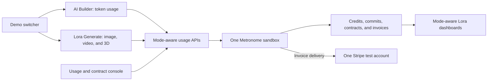

# Unified Lora Billing Demo

## Architecture

## Demo story

1. **Launch:** introduce Lora's Free, Pro, and Premium subscription strategy. Begin the live demo on the pricing page.
2. **Hybrid self-serve:** sign up for Free, run two 50-credit generation jobs, show the 100-credit trial being consumed, prompt an upgrade to Premium, collect a payment method with Stripe Checkout in setup mode, and create the Premium Metronome contract.
3. **Quickstart Enterprise:** open a prepared existing customer directly on an Enterprise contract, seed backdated usage in roughly 15 seconds, and show usage by modality, `model`, `user_id`, project, and quality. Demonstrate low-balance alerts and auto top-up.
4. Continue in Stripe's Metronome customer view and Metronome's contract details.

The Enterprise example is a 12-month, $100,000 prepaid commitment with five seats, $2,000 in monthly credits per seat, and a 15% usage-rate discount.

## Project strategy

- Build only in this independent repository. Do not modify the source project at `/Users/linashen/stripe/git/lora-met-apac/demoeng-lora-metronome`.
- Make this the unified presenter app with an explicit **AI Builder** / **Lora Generate** switcher.
- Restore the proven AI Builder experience from the source under its own route while preserving the completed generation experience.
- Share the Lora shell, credentials, Tools panel, Stripe integration, customer utilities, and Metronome client.
- Keep mode-specific routes, catalogs, package resolution, usage schemas, seeders, dashboards, customers, and local storage isolated.
- Prefix or namespace package names and aliases (for example `AI Builder Premium` and `Generate Premium`) so generic Free/Premium/Enterprise matching cannot select the wrong catalog.
- Use separate demo customers for each mode even though both modes share one Metronome and Stripe account pair.
- Keep all image, video, and 3D results synthetic. Only billing objects and usage events use real sandbox APIs.

## Pricing and catalog

- Use a custom pricing unit where one generation credit has a $0.01 list value.
- Use separate metrics and products for image jobs, video seconds, and 3D jobs.
- Stable dimensions: `operation`, `quality`, `model`, `workspace_id`, `project_id`, and `user_id`.
- Pricing dimensions: operation, quality, and model. Workspace, project, and user remain attribution dimensions.
- Keep rates in `src/config/generationCatalog.ts`.
- Initial packages:
  - Free: 100 one-time credits
  - Pro: $20/month and 1,000 credits
  - Premium: $99/month and 8,000 credits
  - Studio: $70/month, 5,500 pooled credits, and $10 per additional seat
  - API PAYG: non-expiring prepaid credits
  - Enterprise: configurable commitment, credits, seats, dates, and rate multiplier

## Product experience

- Add a persistent demo switcher to the shared navigation and presenter controls.
- Route AI Builder to its original chat/token workflow and Lora Generate to the Image, Video, and 3D playground.
- Preserve direct URLs so each storyline can be opened in prepared presentation tabs.
- Display the exact cost before each job and the remaining balance after success.
- Emit usage only after a successful simulated job, using deterministic transaction IDs.
- Consume the Free allowance in two meaningful 50-credit jobs.
- Add profile presets for Individual, Team, API, and Enterprise without changing the core event schema.

## Contracts and usage

- Every demo customer gets distinct Metronome and Stripe customer IDs.
- Store `demo_mode` metadata or a consistent name/alias prefix on prepared customers so lookup and cleanup remain safely scoped.
- Resolve packages by configured IDs or mode-specific aliases, never by generic names alone.
- Self-serve follows Free → Premium.
- Quickstart starts directly on Enterprise and has no Free contract or transition.
- Fix the upgrade defect by ending Free and starting Premium at the same exact timestamp. Never archive Free and backdate Premium; usage before the boundary must remain on Free.
- Seed deterministic generation usage within Metronome's ingestion window for healthy, at-risk, burst, multi-user, and multi-project stories.
- Configure Enterprise with:
  - $100,000 prepaid commitment over 12 months
  - Five seats
  - $2,000 recurring monthly credits per seat
  - Monthly credits at a lower burn priority than the prepaid commitment
  - A 0.85 usage multiplier

## Dashboard and Stripe

- Report balances in generation credits.
- Filter and group by modality, operation, quality, model, project, workspace, and user.
- Keep Stripe as the collection rail. Metronome owns rating, credits, commitments, and invoice generation.
- Demonstrate pooled credits, seat allocations, burn order, discounts, auto top-up, and invoice reconciliation.

## Credentials

Credentials are intentionally deferred. Later verification requires:

- `METRONOME_API_KEY`
- `STRIPE_SECRET_KEY`
- `STRIPE_PUBLISHABLE_KEY`
- `NEXT_PUBLIC_STRIPE_PUBLISHABLE_KEY`
- A connected Metronome Stripe integration and delivery method

Never commit credentials. No model-provider credentials are required.

## Implementation checklist

- [x] Create the independent project from the approved Lora source
- [x] Define the generation catalog and event schema
- [x] Complete and wire the synthetic generation playground
- [x] Implement the exact-boundary Free-to-Premium transition
- [x] Build the prepared Enterprise Quickstart and reset controls
- [x] Adapt usage seeding and dashboard dimensions
- [ ] Add the unified demo-mode configuration and switcher
- [ ] Restore AI Builder under isolated routes
- [ ] Namespace package resolution, customer state, seeding, dashboards, and cleanup by mode
- [ ] Re-run both presenter stories through the unified app
- [ ] Add catalog provisioning
- [x] Run lint and build
- [ ] Verify live Metronome and Stripe behavior once credentials are supplied
- [x] Add setup and presenter runbooks
